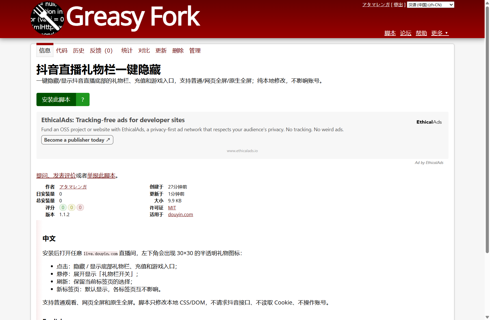
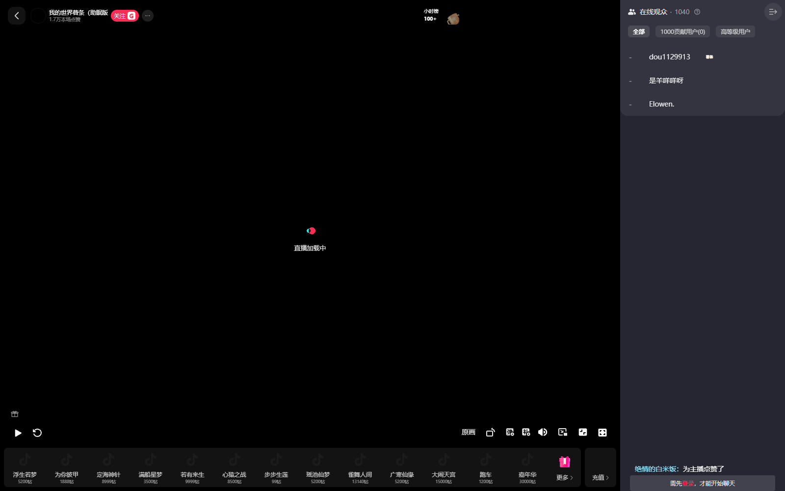
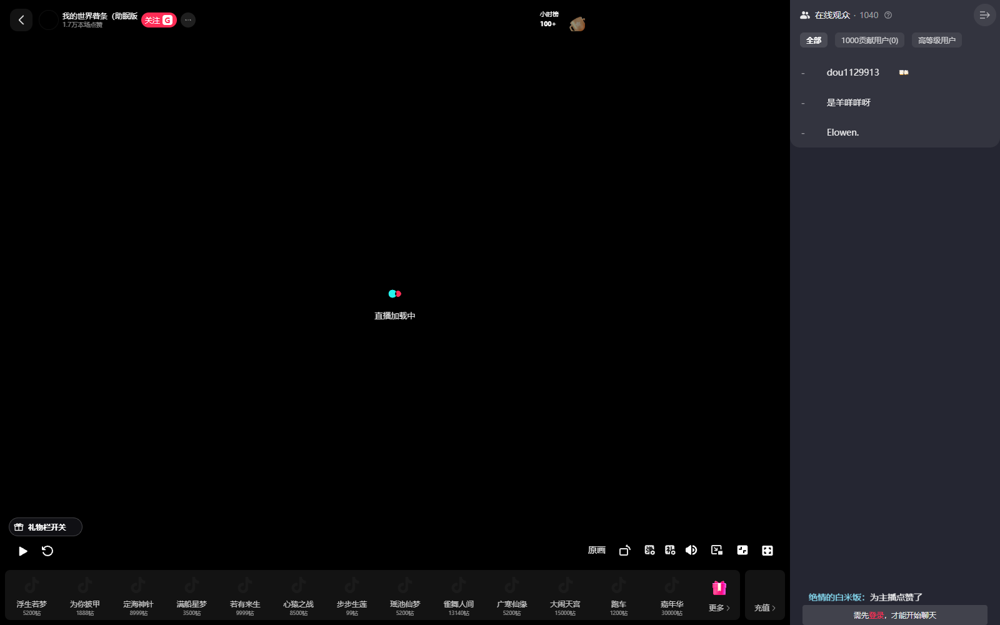
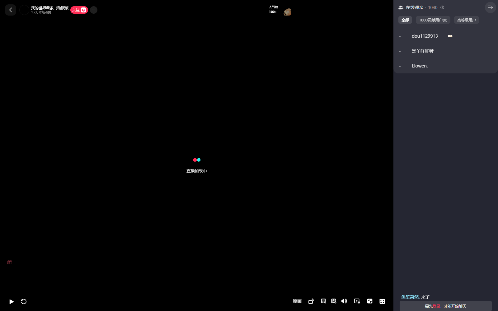
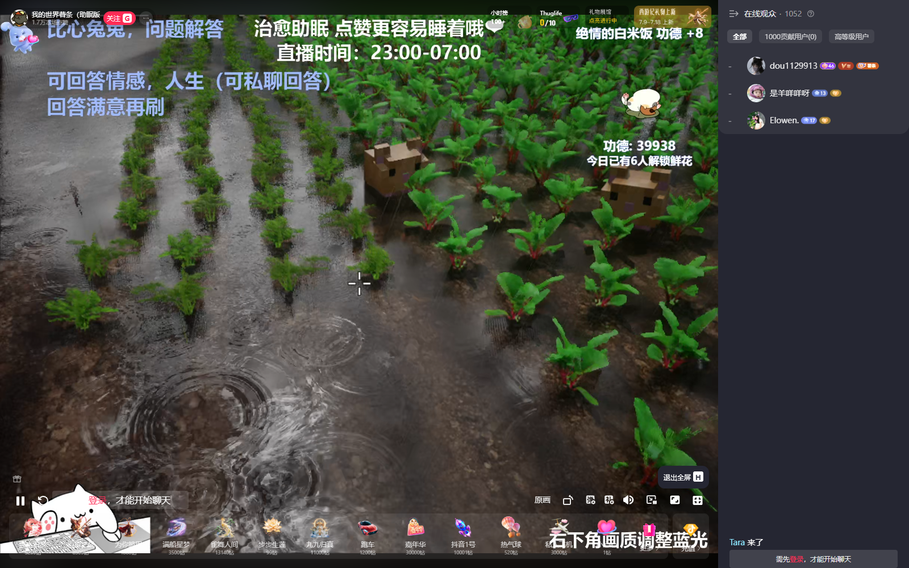
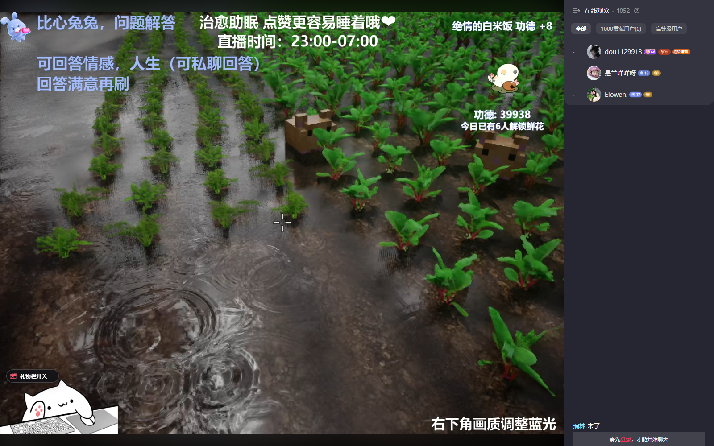
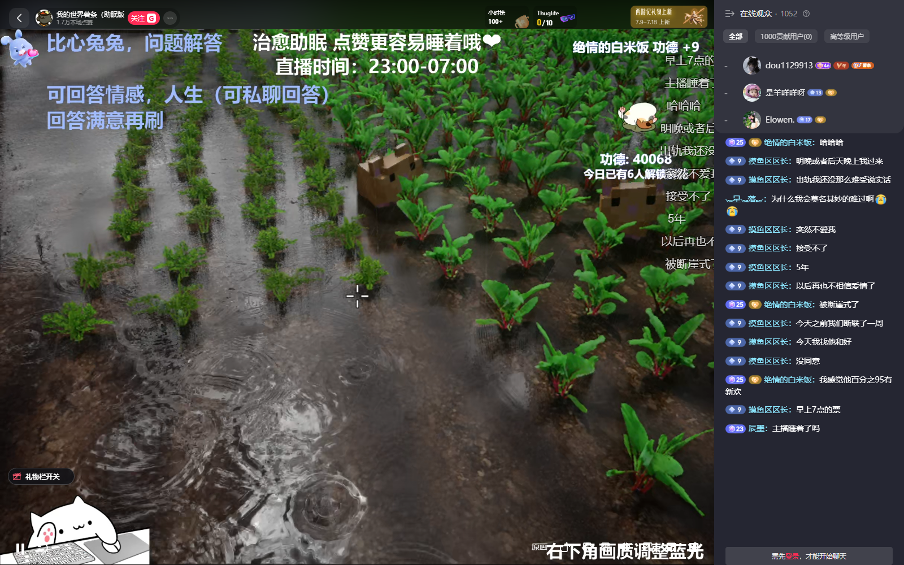
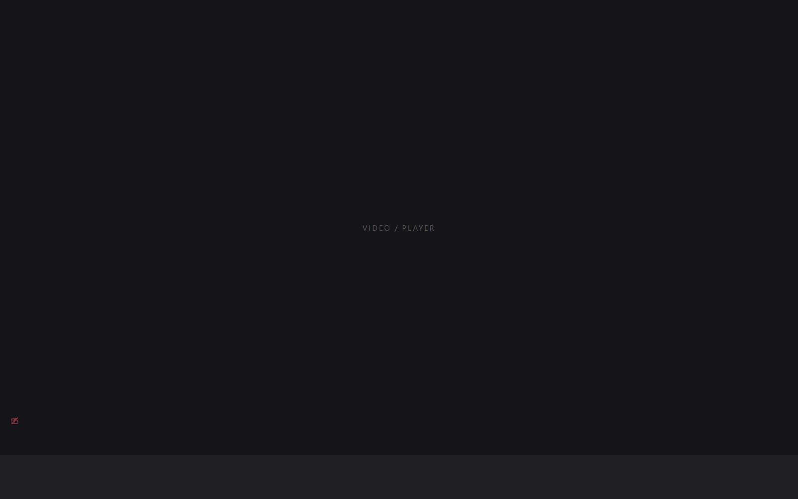

# 抖音直播 · 礼物栏开关

一个完全跑在油猴（Tampermonkey / Violentmonkey）里的本地小脚本：在抖音直播页左下角加一个悬浮按钮，一键隐藏 / 显示底部的**礼物栏、充值入口、游戏入口**。不改抖音请求、不碰账号、不依赖后端。

**Greasy Fork 已发布：** [抖音直播礼物栏一键隐藏](https://greasyfork.org/zh-CN/scripts/606215) · [English listing](https://greasyfork.org/en/scripts/606215) · 版本 `1.1.2` · 许可证 MIT

**GitHub：** <https://github.com/NooBlock/douyin-live-gift-toggle>

## 文件

| 文件 | 说明 |
| --- | --- |
| [`douyin-live-gift-toggle.user.js`](./douyin-live-gift-toggle.user.js) | 油猴脚本本体，直接安装这个文件即可 |
| [`LICENSE`](./LICENSE) | MIT 许可证 |
| [`test/run_tests.py`](./test/run_tests.py) | 真实直播间端到端测试（隔离浏览器、不登录） |
| [`test/run_mode_harness.py`](./test/run_mode_harness.py) | 普通 / 网页全屏 / 元素级原生全屏的可控测试 |
| [`test/modes.html`](./test/modes.html) | 三模式测试页 |
| [`test/evidence/`](./test/evidence/) | 测试截图与 JSON 报告 |
| [`greasyfork-listing.md`](./greasyfork-listing.md) | Greasy Fork 发布用的中英文标题、描述与附加说明 |

## 安装

1. 浏览器安装 [Tampermonkey](https://www.tampermonkey.net/) 或 Violentmonkey。
2. 打开扩展的「添加新脚本」，把 [`douyin-live-gift-toggle.user.js`](./douyin-live-gift-toggle.user.js) 全文粘贴进去，保存。
   - 也可以直接把 `.user.js` 文件拖进浏览器，按扩展提示安装。
3. 打开任意抖音直播间（脚本不绑定房间号）。
4. 左下角会出现一个 **30×30 的半透明礼物小图标**，默认不显示文字、不显示底色：
   - 鼠标移上去（或键盘聚焦）才展开为「礼物栏开关」胶囊，显示深色底；
   - 点击后底部礼物 / 充值 / 游戏整条消失，图标变成红色带斜杠；
   - 再点一次恢复。

按钮位置固定在播放器左下、播放器控制条上方。网页全屏、浏览器原生全屏、F11 全屏时都会保留。

## Greasy Fork

- 中文页面：[greasyfork.org/zh-CN/scripts/606215](https://greasyfork.org/zh-CN/scripts/606215)
- English listing: [greasyfork.org/en/scripts/606215](https://greasyfork.org/en/scripts/606215)
- 直接安装：<https://update.greasyfork.org/scripts/606215/%E6%8A%96%E9%9F%B3%E7%9B%B4%E6%92%AD%E7%A4%BC%E7%89%A9%E6%A0%8F%E4%B8%80%E9%94%AE%E9%9A%90%E8%97%8F.user.js>

许可证：**MIT**。允许修改、再发布和商业使用，只需保留版权与许可证声明，作者不承担担保责任。



## 行为细节

- **外观**：默认只有 30×30 的礼物 logo，整体半透明（`opacity: 0.58`），无文字、无底色，尽量不遮挡画面；悬停 / 键盘聚焦时宽度展开到 118px，显示「礼物栏开关」和 `rgba(18,18,22,.9)` 深色底，移开鼠标自动收回。
- **隐藏范围**：`#BottomLayout`（底部礼物栏整体），以及作为兜底的 `#giftPanelEntrance`、`[data-e2e="gifts-container"]`、`[data-e2e="gifts-switch"]`、`[data-e2e="recharge-btn"]`。
- **不隐藏**：播放器、弹幕、聊天区、顶部房间信息、点赞 / 分享等播放器控制。
- **刷新**：当前标签页的选择会保留（`sessionStorage`），刷新后礼物栏不会先闪一下再消失。
- **多标签页**：每个标签页独立；A 标签页隐藏，不会影响 B 标签页。新开标签页默认显示。
- **全屏**：
  - 普通观看：左下角悬浮按钮；
  - 抖音网页全屏 / 浏览器 F11：按钮是 `position: fixed`，不依赖侧栏宽度，仍可见；
  - 原生全屏：监听 `fullscreenchange`，若全屏元素不是 `<body>`，会把按钮重新挂到全屏元素内部（`<video>` 全屏时无法挂载，脚本保留 `<body>` 兜底）。
- **资源占用**：只注入 1 个 `<style>`、创建 1 个按钮；没有 `setInterval`、没有持续轮询、没有常驻 `MutationObserver`。只有页面极早期 `<html>` 尚未创建时，才用一个短命 observer 等 `<html>` 出现后立即断开。

## 风控与隐私

脚本只做两件事：

1. 在 `<html>` 上写本地属性 `data-dygt-gifts="on|off"`，配一段 CSS `display: none !important`；
2. 创建并移动一个悬浮 `<button>`。

它**不会**：

- 请求抖音接口 / 发送任何网络请求；
- 读取 Cookie、Token、登录态或账号信息；
- 自动点击送礼、充值、游戏、关注、登录；
- 使用 `localStorage` 做跨标签共享；
- 引入外部 JS / 字体 / 图片。

因此它不改变账号侧的任何状态，也不会产生礼物 / 充值行为。需要说明的是：任何页面内脚本都无法从原理上承诺“绝对不会被平台检测”，但本脚本把行为限制在纯本地 CSS/DOM，风险面已经降到最低。

## 验证结果

真实页面（`https://live.douyin.com/927864631944`，主页当前在线房间；隔离浏览器、无登录、只点脚本按钮和播放器全屏按钮）：

- **30 项通过 / 0 失败**
- 覆盖：默认只显示半透明 logo、悬停展开插件名 / 底色、移开收回、点击隐藏、ARIA、刷新保持、恢复显示、播放器控制层未误隐藏、原生全屏进入 / 隐藏 / 退出、多标签页独立、缩小视口按钮不越界。
- 报告：[`test/evidence/report.json`](./test/evidence/report.json)

> 你最初给的 `543221183540` 在复验时已经显示「直播已结束」，因此最终回归改用了主页另一个在线房间；脚本本身不绑定房间号，选择器对任意在线直播间一致。

三模式可控测试（补足当前直播页没有单独「网页全屏」按钮的情况）：

- **10 项通过 / 0 失败**
- 覆盖：普通布局、网页全屏布局切换、元素级原生全屏时按钮重挂载、退出全屏回 `<body>`。
- 报告：[`test/evidence/synthetic-report.json`](./test/evidence/synthetic-report.json)

关键截图：

| 普通 · 默认图标 | 悬停 · 展开插件名 |
| --- | --- |
|  |  |

| 普通 · 隐藏 | 原生全屏 · 显示 |
| --- | --- |
|  |  |

| 原生全屏 · 隐藏 | 多标签页独立 |
| --- | --- |
|  |  |

| 网页全屏模拟 |
| --- |
|  |

## 自定义

按钮样式和位置都在脚本顶部的 `CSS` 常量里：

```css
#dygt-gift-toggle {
  left: max(14px, env(safe-area-inset-left, 0px)) !important;
  bottom: 142px !important; /* 想更靠下可调小，例如 118px */
}
```

隐藏范围如果要扩大，往这段选择器里加即可：

```css
html[data-dygt-gifts="off"] #BottomLayout,
html[data-dygt-gifts="off"] #giftPanelEntrance,
...
```

## 运行测试（可选）

脚本本身只需要浏览器 + 油猴，不需要 Node / Python。测试用 Python + Playwright：

```powershell
python -m pip install playwright
python -m playwright install chromium
python test/run_mode_harness.py
python test/run_tests.py
```

如果本机已有 Chrome / Chromium，也可以不装 Playwright 浏览器，设置 `DY_CHROME` 指向可执行文件即可。真实页面测试会打开一个隔离的 Chromium 配置目录，不读取你日常浏览器的 Cookie / 登录态；测试过程中不会点击礼物、充值、游戏或登录。

## 兼容性

- Chrome / Edge / Firefox 的当前版本；
- Tampermonkey、Violentmonkey；
- `@match https://live.douyin.com/*`，只在直播页生效；
- `@noframes`，不会进入直播间内嵌 iframe；
- `@grant none`，不申请任何 GM 权限。

## 卸载

在油猴扩展里删除「抖音直播 · 礼物栏开关」即可。所有界面改动都在页面内，删除脚本并刷新页面后不会残留。
